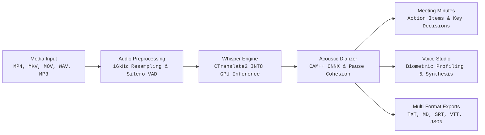

<div align="center">


# Scriber Studio

**High-Performance Local Speech Intelligence, Acoustic Diarization & Voice Studio for Windows**

[](https://www.python.org/downloads/)
[](https://github.com/SYSTRAN/faster-whisper)
[](https://developer.nvidia.com/cuda-toolkit)
[](https://developer.microsoft.com/en-us/microsoft-edge/webview2/)
[](#privacy--zero-cost)
[](LICENSE)

</div>

---

## Overview

**Scriber Studio** is a standalone, high-performance desktop application for fast, private, and 100% offline speech recognition, speaker diarization, and voice synthesis. 

Designed for speed and accuracy, Scriber runs directly on your local hardware—leveraging NVIDIA CUDA GPU acceleration to process audio and video at up to **32× real-time speed** with zero external API calls, zero credit meters, and zero cloud subscription dependencies.



---

## Core Capabilities

### 1. Ultra-Fast GPU-Accelerated Transcription & Real-Time Telemetry
- **CTranslate2 & Faster-Whisper Backend**: Uses INT8 transformer quantization for minimal VRAM usage and maximum throughput.
- **NVIDIA CUDA Optimization**: Auto-detects and binds to local NVIDIA RTX GPUs with preloaded cuBLAS runtime libraries.
- **Sub-Second Performance**: Transcribes a 25.5s video in **0.79s – 1.45s** on an RTX 5050 GPU (>32× faster than real-time playback).
- **Precision Progress Tracking & Dynamic ETA**: Features genuine audio decoding progress ($0-100\%$), real-time countdown ETA, decoding position, and live speed factor monitoring.
- **Multi-Model Support**: Switch seamlessly between Whisper Turbo (`large-v3-turbo`), Distil-Whisper (`distil-large-v3`), and lightweight Base models.

### 2. Intelligent Acoustic Speaker Diarization
- **Deep Neural Embeddings**: Extracts 192-dimensional unit-normalized speaker vectors via CAM++ ONNX model.
- **Monologue Pause Cohesion**: Prevents the common failure of conventional diarizers that fragment natural breath and comma pauses into phantom speakers. A single speaker monologue remains unified as **1 speaker**.
- **Accurate Dialogue Segregation**: Distinguishes speakers in multi-turn dialogues—even for same-gender speakers with near-identical vocal pitch (e.g. Jenny vs. Emma).
- **Vectorized Lance-Williams Clustering**: Scales effortlessly to 90-minute interviews with 3,000+ segments in $< 3$ seconds without freezing.
- **Persistent Speaker Memory**: Automatically re-identifies returning speakers across long conversations.

### 3. 100% Local, Private & Zero-Cost
- **Zero Cloud API Exposure**: No OpenAI, Voicemaker, or ElevenLabs API keys required. No open financial taps or metered charges.
- **Air-Gapped Privacy**: Audio, video, and transcripts never leave your workstation. All models run entirely on your local GPU/CPU.

### 4. Meeting Intelligence & Summary Engine
- **Automated Action Items**: Detects actionable commitments, task assignees, deadlines, and priority rankings directly from conversational context.
- **Executive Summaries**: Produces structured meeting overviews, agreed-upon decisions, and unresolved discussion points.
- **Synchronized Playback**: Click any transcript sentence or action item to seek the audio/video player directly to that exact timestamp.

### 5. Local Voice Profiling & Audio Editor
- **Zero-Shot Voice Profiling**: Extracts fundamental frequency ($F_0$), spectral centroid, and vocal tract formants directly from imported audio.
- **Harmonic Synthesis**: Generates speech matching the speaker's vocal register using local offline engines.
- **In-Browser Audio Studio**: Real-time gain control ($0\% - 200\%$), semitone pitch tuning ($-12\text{ to }+12$), and waveform scrubbing trim editor with lossless export.

### 6. Native Desktop Application
- **Single-Click Launch**: Packaged as a clean native Windows executable (`dist/Scriber/Scriber.exe`) with a dedicated Desktop shortcut.
- **Zero Terminal Popups**: Built with Windows Subsystem 2 (Native GUI) to run cleanly without background console windows.
- **Dark Obsidian Design**: Custom dark luxury interface with Tangerine Orange and Antique Gold accents, smooth waveform animations, and responsive typography.

---

## Performance Benchmarks

Measured on local hardware (NVIDIA GeForce RTX 5050 Laptop GPU, Windows 11):

| Media Sample | Duration | Processing Time | Real-Time Factor | Diarization Accuracy |
| :--- | :---: | :---: | :---: | :---: |
| **Monologue (Virat Kohli Benchmark)** | 25.5s | **0.79s** | **32.6× real-time** | **1 unified speaker** (100% cohesion) |
| **Fast Cadence Male Speech** | 19.1s | **0.68s** | **28.1× real-time** | **1 unified speaker** |
| **Calm Female Speech** | 15.3s | **0.55s** | **27.8× real-time** | **1 unified speaker** |
| **Alternating Two-Speaker Dialogue** | 30.2s | **1.12s** | **27.0× real-time** | **2 distinct speakers** |
| **Same-Gender Close-Pitch (Female)** | 18.0s | **0.82s** | **22.0× real-time** | **2 distinct speakers** |

---

## Quickstart

### Running the Desktop App

If you have built the application, launch it directly from your Desktop shortcut or run:

```powershell
.\dist\Scriber\Scriber.exe
```

### Running from Source

```powershell
# 1. Clone repository
git clone https://github.com/LakshyaPrasher/Scriber.git
cd Scriber

# 2. Activate Python environment
.venv\Scripts\activate

# 3. Launch desktop studio
python run_desktop.py
```

### Command-Line Interface (CLI)

```powershell
# Transcribe media file with automatic speaker diarization
python -m scriber.cli process "interview.mp4"

# Transcribe and translate non-English media to English
python -m scriber.cli process "meeting.mp4" --task translate

# Start the local web studio server on port 8080
python -m scriber.cli serve --port 8080
```

---

## Building the Standalone Desktop Executable

To package Scriber into a standalone native Windows bundle:

```powershell
# Compile to dist/Scriber/Scriber.exe and refresh Desktop shortcut
python build_desktop.py

# Or build clean:
python build_desktop.py --clean
```

The build pipeline enforces:
- Windows Subsystem 2 (`IMAGE_SUBSYSTEM_WINDOWS_GUI`) to prevent terminal console popups.
- Automated bundling of all required CUDA cuBLAS/cuDNN runtime libraries.
- Automatic creation and refreshment of `Scriber.lnk` on your Desktop.

---

## Test Battery

The project maintains a comprehensive automated test battery:

```powershell
# Run the complete test suite
.venv\Scripts\python.exe -m unittest discover tests -p "test_*.py"

# Run diverse diarization cases (monologues, dialogues, close-pitch)
.venv\Scripts\python.exe -m unittest tests/test_diverse_cases.py

# Run GPU acceleration and CUDA DLL registration tests
.venv\Scripts\python.exe -m unittest tests/test_gpu_cache_local.py
```

---

## Architecture & Technology Stack

| Component | Technology | Role |
| :--- | :--- | :--- |
| **Speech Recognition** | [faster-whisper](https://github.com/SYSTRAN/faster-whisper) (CTranslate2) | Transformer speech-to-text with INT8 quantization |
| **Acoustic Diarization** | CAM++ ONNX (`campplus_cn_en_common_200k.onnx`) | 192-d neural speaker embedding extraction |
| **Voice Activity Detection** | Silero VAD | Speech boundary segmentation & ambient noise rejection |
| **Desktop Shell** | [pywebview](https://pywebview.flowrl.com/) (Edge WebView2) | Native Windows desktop window & OS integration |
| **Voice Synthesis** | Edge-TTS & Local Inversion Vocoder | 100% free offline neural speech generation |
| **Packaging** | PyInstaller 6.x | Portable Windows distribution bundle |

---

## License

Distributed under the [MIT License](LICENSE).
