<div align="center">


# Scriber

**Autonomous Video Intelligence, Whisper Flow Transcription, Acoustic Diarization & Voice Synthesis Studio**

[](https://www.python.org/downloads/)
[](https://github.com/SYSTRAN/faster-whisper)
[](https://developer.microsoft.com/en-us/microsoft-edge/webview2/)
[](#5--cryptographic-validation-engine--accuracy-guarantee)
[](LICENSE)

</div>

---

## 🌟 Overview

**Scriber** is an intelligent, high-precision video and audio intelligence platform. It seamlessly transforms any multimedia file into perfectly formatted, speaker-diarized transcripts, executive discussion summaries, and actionable tasks. Powered by a hybrid acoustic intelligence engine and a standalone native desktop studio, Scriber delivers uncompromising performance, local privacy, and luxury design.

```mermaid
flowchart TD
    A["<b>Input Media Ingestion</b><br/><code>MP4 • MKV • MOV • WebM • AVI • WAV • MP3 • FLAC</code>"]
    B["<b>Audio Extractor &amp; VAD</b><br/><code>16kHz Mono Resampling • Silero VAD v6 Voice Segmentation</code>"]
    C["<b>Sub-Agent 1: Whisper Flow Engine</b> (scriber.transcription_engine)<br/>• High-throughput CTranslate2 INT8 transformer quantization<br/>• Multi-task tokens, word-level timestamps, hallucination suppression"]
    D["<b>Sub-Agent 2: Quality Check Guard</b> (scriber.quality)<br/>• Repetition loop penalty (zlib compression ratio &lt; 2.4)<br/>• Silence hallucination culling (no-speech prob filter)<br/>• Monotonicity &amp; human speaking rate (WPM) checks"]
    E["<b>Acoustic Speaker Diarizer</b> (scriber.diarizer)<br/>• Fundamental frequency (F0) &amp; Spectral Centroid biometrics<br/>• Conversational continuity prior for single-speaker cohesion<br/>• 100% Biometric speaker memory retention across dialogue turns"]
    F["<b>Sub-Agent 3: Supreme Council Intelligence</b> (scriber.council)<br/>• Action Items (Task, Assignee, Priority, Deadline, Timestamps)<br/>• Thematic Discussion Chapters &amp; Topic Modeling<br/>• Executive Briefing: Headline, TL;DR, Decisions, Blockers"]
    G["<b>Voice Cloning Studio</b> (scriber.voice_clone)<br/>• Zero pre-set voices: direct media biometric profiling<br/>• Dynamic vocal profile extraction (Pitch, Formants, Timbre)<br/>• Biometric cosine similarity verification (&ge; 99% fidelity)"]
    H["<b>Sub-Agent 4: Validation Engine</b> (scriber.validator)<br/>• NIST/Kaldi Word Error Rate (WER) via Levenshtein edit distance<br/>• Strict 99.0% - 99.9% accuracy threshold enforcement<br/>• Cryptographic Validation Certificates (CERT-CSCR-XXXXXX)"]
    I["<b>Multi-Format Exporters</b><br/><code>TXT • Markdown • HTML Dashboard • SRT • VTT • JSON</code>"]

    A --> B
    B --> C
    C --> D
    D --> E
    E --> F
    F --> G
    G --> H
    H --> I
```



### 🏛️ Pipeline Architecture & Sub-Agent Specification

| Stage | Subsystem / Agent | Module Path | Core Capabilities & Technical Guarantees |
| :---: | :--- | :--- | :--- |
| **01** | **Ingestion & VAD** | `scriber.audio` | 16kHz mono resampling, universal FFmpeg container extraction, Silero VAD v6 voice activity chunking. |
| **02** | **Whisper Flow** | `scriber.transcription_engine` | High-throughput CTranslate2 INT8 transformer quantization, multi-task decoding (`transcribe`/`translate`), word timestamps. |
| **03** | **Quality Guard** | `scriber.quality` | Repetition looping penalty (`zlib` ratio &lt; 2.4), silence hallucination culling, speaking rate (WPM) checks. |
| **04** | **Acoustic Diarizer** | `scriber.diarizer` | Fundamental frequency ($F_0$) & Spectral Centroid biometrics, conversational continuity prior, multi-turn memory. |
| **05** | **Supreme Council** | `scriber.council` | Action item extraction with assignees and deadlines, thematic discussion chapters, executive briefings (TL;DR, decisions). |
| **06** | **Voice Cloning** | `scriber.voice_clone` | Dynamic media profiling, zero hardcoded presets, harmonic pitch/timbre cloning, cosine similarity validation (&ge; 99%). |
| **07** | **Validation Engine** | `scriber.validator` | NIST/Kaldi Word Error Rate (WER) via Levenshtein edit distance, 99.0%–99.9% accuracy threshold, cryptographic certificates. |
| **08** | **Multi-Format Export** | `scriber.export` | Automated output generation: `.txt`, `.md`, `.srt`, `.vtt`, `.json`, and interactive HTML dashboard. |

---

## ✨ Key Capabilities

### 1. 👥 Intelligent Acoustic Diarization & Cohesion
- **No False Segmentation**: Conventional diarizers fragment natural sentence pauses into multiple phantom speakers. Scriber uses a **Conversational Continuity Prior** ($\Delta F_0 \le 28\text{ Hz}$, $\Delta SC/SC \le 15\%$) ensuring single-speaker monologues stay unified under a single speaker card.
- **Biometric Memory Retention**: Accurately recognizes and tags returning speakers even after minutes of silence or intermediate dialogue turns.
- **Zero-Cloud Requirement**: Runs entirely on local CPU/GPU using pure signal processing and Silero VAD v6.

### 2. ⚡ Bespoke Studio Audio Player & Zero-Latency Waveform Scrubber
- **Native Web Audio API Decoding**: Decodes real audio into 64 normalized amplitude bars rendered on a sleek obsidian glass canvas.
- **Accurate Canvas-Level Seeking**: Eliminates container padding offsets. Clicking midway seeks to the precise halfway timestamp with zero delay.
- **Live Reactive Scrubber**: Real-time scrubbing synchronizes timecodes, word highlights, and active speaker cards instantaneously on `mousedown`.

### 3. 🎙️ Pure File-Based Voice Cloning Studio
- **No Hardcoded Presets**: The voice cloning studio starts completely clean. Upload an MP3/WAV file to profile the speaker's biometric vocal timbre.
- **Harmonic Vocal Synthesis**: Generates speech matching the reference speaker's fundamental pitch ($F_0$), formant dispersion, and speaking cadence.
- **Differentiated Animation**: Voice cloning features a distinctive high-frequency oscillation rate and pitch dynamics compared to transcription visualizers.

### 4. 🖥️ Native Standalone Desktop Studio
- **Packaged Executable**: Single-click desktop application powered by Microsoft Edge WebView2 (`Scriber.exe`).
- **Dark Luxury UI**: Dark Obsidian (`#08090C`, `#0D0F14`) canvas, Tangerine Orange (`#FF5E00`), and Antique Gold (`#FFA826`) accents with fluid organic liquid morphing animations.
- **Native OS Bridges**: Native open-file dialogs, save-file dialogs, and instant "Reveal in Explorer" buttons.
- **Automatic Multi-Format Exports**: Saves clean `.txt`, `.md`, `.srt`, `.vtt`, and `.json` files automatically into `./scriber_output`.

### 5. 🧪 Cryptographic Validation Engine & Accuracy Guarantee
- **NIST/Kaldi WER Benchmark**: Validates speech-to-text accuracy against ground truth using Levenshtein distance metrics.
- **Strict Accuracy Enforcement**: Enforces a strict 99.0% - 99.9% accuracy threshold before issuing verification seals.
- **Cryptographic Audit Certificates**: Generates serialized verification certificates (`CERT-CSCR-XXXXXX`) documenting transcription fidelity, WER, and biometric continuity scores.

---

## 🚀 Quickstart & Usage

### Option A: Launch Standalone Desktop Studio

```bash
# Launch desktop studio window
python run_desktop.py

# Or launch directly from the compiled binary:
.\dist\Scriber\Scriber.exe
```

### Option B: Command-Line Interface (CLI)

```bash
# Process video or audio file
python -m scriber.cli process interview.mp4 --task transcribe --lang en

# Clone speaker voice from an audio clip
python -m scriber.cli clone-voice sample.mp3 --text "Welcome to the future of voice intelligence." --out speech.wav

# Run accuracy benchmark suite
python -m scriber.cli benchmark
```

### Option C: Standalone Web Server

```bash
python -m scriber.cli serve --port 8080
# Open http://127.0.0.1:8080 in your browser
```

---

## 🛠️ Building the Standalone Desktop Executable

Scriber includes a built-in automated compiler using PyInstaller and Microsoft Edge WebView2:

```bash
# Build localized desktop bundle (dist/Scriber/Scriber.exe)
python build_desktop.py --clean

# Build with debug console visible
python build_desktop.py --console
```

The output bundle packages:
- CTranslate2 INT8 Whisper inference engine
- Silero VAD v6 ONNX activity detection weights
- Microsoft Edge WebView2 runtime bridge
- Bespoke Scriber brand assets (ICO, PNG, SVG)

---

## 🧪 Automated Test Suite

Scriber is covered by extensive unit and integration tests:

```bash
# Run all 88 automated unit tests
python -m unittest discover tests

# Run 20-sample acoustic diarization benchmark
python -m tests.suite_20_evaluator
```

---

## 📄 License

Distributed under the MIT License. See `LICENSE` for details.
