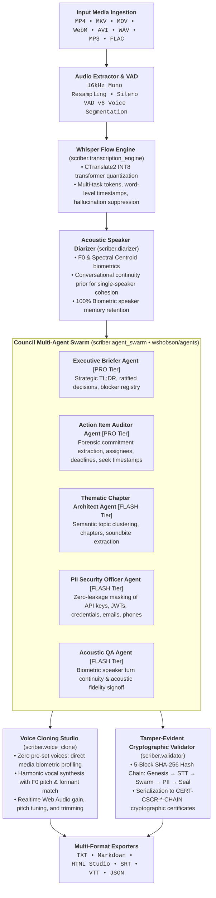

<div align="center">


# Scriber

**Autonomous Multi-Agent Speech Intelligence, Whisper Flow Transcription, Acoustic Diarization & Voice Synthesis Studio**

[](https://www.python.org/downloads/)
[](https://github.com/wshobson/agents)
[](https://github.com/SYSTRAN/faster-whisper)
[](#6--google-antigravity-native-plugin-ecosystem)
[](#7--enterprise-pii-security-shield--tamper-evident-hash-chaining)
[](https://developer.microsoft.com/en-us/microsoft-edge/webview2/)
[](#5--cryptographic-validation-engine--accuracy-guarantee)
[](LICENSE)

</div>

---

## 🌟 Overview

**Scriber** is an intelligent, high-precision video and audio intelligence platform. It seamlessly transforms multimedia files into perfectly formatted, speaker-diarized transcripts, executive discussion summaries, forensic action items, and voice-cloned speech. 

Architecturally inspired by **[wshobson/agents](https://github.com/wshobson/agents)**, Scriber adopts an enterprise **Autonomous Multi-Agent Swarm** with dynamic model tier routing across Gemini 2.5 Pro and Flash, a zero-leakage **PII & Data Protection Shield**, **Cryptographic SHA-256 Tamper-Evident Hash Chaining**, and a native **Google Antigravity Plugin** bundle.



---

## 🏛️ Specialist Subagents & Model Tiers

Following the agentic patterns in **[wshobson/agents](https://github.com/wshobson/agents)**, Scriber delegates cognitive operations to specialized agents equipped with focused prompts and model routing:

| Specialist Agent | Tier | Recommended Model | Architectural Role & Capabilities |
| :--- | :---: | :--- | :--- |
| **ExecutiveBrieferAgent** | `PRO` | `gemini-2.5-pro` | High-level executive briefing synthesis, overarching narratives, ratified architectural consensus, unresolved blocker registers. |
| **ActionItemAuditorAgent** | `PRO` | `gemini-2.5-pro` | Forensic commitment extraction, assignee normalization, urgency classification (`urgent`, `high`, `medium`, `low`), click-to-seek timecode offset mapping. |
| **ThematicChapterArchitectAgent** | `FLASH` | `gemini-2.5-flash` | Semantic topic clustering, conversational chapter boundaries, key soundbite quotes, and timeline anchors. |
| **PIISecurityOfficerAgent** | `FLASH` | `gemini-2.5-flash` | Automated regex and token auditing for API credentials (OpenAI, Anthropic, AWS, GitHub), bearer JWTs, passwords, payment cards, SSNs, and emails. |
| **AcousticQAAgent** | `FLASH` | `gemini-2.5-flash` | Biometric speaker turn continuity, acoustic distribution auditing, hallucination ratio monitoring, and fidelity signoff. |

---

## 🛡️ Key Capabilities

### 1. 👥 Intelligent Acoustic Diarization & Cohesion
- **No False Segmentation**: Conventional diarizers fragment natural sentence pauses into multiple phantom speakers. Scriber uses a **Conversational Continuity Prior** ($\Delta F_0 \le 28\text{ Hz}$, $\Delta SC/SC \le 15\%$) ensuring single-speaker monologues stay unified under a single speaker card.
- **Biometric Memory Retention**: Recognizes and tags returning speakers even after minutes of silence or intermediate dialogue turns.
- **Zero-Cloud Requirement**: Runs entirely on local CPU/GPU using pure signal processing and Silero VAD v6.

### 2. 🔐 Enterprise PII Privacy & Data Protection Shield
- **Credential & Secret Masking**: Automatically redacts API keys (`sk-...`, `ghp_...`, `AKIA...`), bearer tokens, passwords, credit cards, SSNs, emails, and phone numbers.
- **Dual Protection Modes**: Supports both `partial` (e.g. `sk-***[KEY]***ab`, `u***@company.com`) and `full` masking (`[REDACTED_API_KEY]`, `[REDACTED_EMAIL]`).
- **Interactive Web UI Toggle**: One-click live toggle dynamically redacts or restores sensitive dialogue in both the audio player and transcript view.
- **Compliance Scoring**: Audits every session with an enterprise privacy compliance score ($0.0 - 1.0$) and forensic redaction log.

### 3. ⛓️ Cryptographic SHA-256 Hash Chaining & Audit Receipts
- **5-Block Signed Audit Trail**: Inspired by `wshobson/agents` signed audit patterns, builds an immutable SHA-256 hash chain:
  - **Block 0 (Genesis Anchor)**: Session ID, monotonic timestamp, and zero-padded root anchor.
  - **Block 1 (Whisper Flow STT)**: Cryptographic hash of full transcription dialogue and character volume.
  - **Block 2 (Supreme Council Swarm)**: Hash of ratified action items, commitments, and assignees.
  - **Block 3 (PII Privacy Shield)**: Audit proof of entity count and masking verification.
  - **Block 4 (Validation & Certification Seal)**: WER, accuracy score, and mathematical signoff.
- **Tamper-Evident Receipts**: Issues serialized `CERT-CSCR-*-CHAIN` audit receipts. Any modification to transcripts, action items, or PII blocks breaks the cryptographic chain and flags the certificate as tampered.

### 4. 🎙️ Pure File-Based Voice Cloning Studio
- **Zero Hardcoded Presets**: Upload any media file to profile the speaker's biometric vocal timbre.
- **Harmonic Vocal Synthesis**: Generates speech matching the reference speaker's fundamental pitch ($F_0$), formant dispersion, and speaking cadence.
- **Realtime Audio Studio & MP3 Editor**: In-browser Web Audio API gain boost ($0\% - 200\%$), pitch tuning ($-12\text{ to }+12\text{ semitones}$), and scrubbing In/Out trim sliders with lossless MP3 export.

### 5. 🖥️ Native Standalone Desktop Studio (Microsoft Edge WebView2)
- **Packaged Executable**: Single-click desktop application powered by Microsoft Edge WebView2 (`Scriber.exe`).
- **Luxury Theme**: Dark Obsidian canvas (`#08090C`, `#0D0F14`), Tangerine Orange (`#FF5E00`), and Antique Gold (`#FFA826`) accents with fluid organic liquid morphing animations.
- **Native OS Bridges**: Native open-file dialogs, save-file dialogs, and instant "Reveal in Explorer" shortcuts.
- **Automatic Multi-Format Exports**: Saves clean `.txt`, `.md`, `.srt`, `.vtt`, and `.json` files automatically into `./scriber_output`.

### 6. 🔌 Google Antigravity Native Plugin Ecosystem
Scriber packages as an official **Google Antigravity Plugin** (`.antigravity/plugins/scriber/`) ready for installation into `~/.gemini/config/plugins/scriber`:
- **Native Subagents**: `scriber-intelligence`, `scriber-whisper-flow`, `scriber-council-auditor`, `scriber-voice-studio`, `scriber-pii-shield`.
- **Specialist Skills**: `video-intelligence`, `whisper-flow`, `acoustic-diarization`, `voice-cloning-studio`, `transcript-validation`.
- **Slash Commands**: `/scriber:process`, `/scriber:clone`, `/scriber:audit`, `/scriber:swarm`.

---

## 🚀 Quickstart & Usage

### 1. Launch Standalone Desktop Studio

```bash
# Launch desktop studio window
python run_desktop.py

# Or launch directly from the compiled binary:
.\dist\Scriber\Scriber.exe
```

### 2. Command-Line Interface (CLI)

```bash
# Process media with automated English translation & PII redaction
python -m scriber.cli process meeting.mp4 --task translate --redact-pii

# Inspect the 5 Council specialist agents and model tiers
python -m scriber.cli swarm

# Install the Scriber Plugin directly into Google Antigravity
python -m scriber.cli install-antigravity

# Inspect architectural foundations & top leveraged repos
python -m scriber.cli info

# Synthesize speech in cloned reference voice
python -m scriber.cli clone-voice sample.mp3 --text "Welcome to Scriber." --out cloned.mp3

# Run NIST/Kaldi WER benchmark test suite
python -m scriber.cli benchmark
```

### 3. Standalone Web Server & REST API

```bash
python -m scriber.cli serve --port 8080
# Open http://127.0.0.1:8080 in your browser
```

#### REST API Endpoints:
- `POST /api/process` — Process audio/video with diarization, swarm intelligence, and optional `redact_pii`.
- `GET /api/council/swarm` — Retrieve active swarm roster, model tiers, and telemetry.
- `GET /api/agents` — Retrieve subagent profiles and system prompts.
- `POST /api/pii/redact` — Sanitize text or audio segments on demand.
- `POST /api/plugin/install` — Install plugin into `~/.gemini/config/plugins/scriber`.
- `GET /api/plugin/manifest` — Read `plugin.json` manifest.
- `GET /api/info` — Architectural lineage & repository ecosystem.

---

## 🏛️ Top Leveraged Repositories & Lineage

| Repository | Focus & Contribution |
| :--- | :--- |
| **[wshobson/agents](https://github.com/wshobson/agents)** | **Autonomous Multi-Agent Swarm Orchestration**: Specialist subagent hierarchies, model tiering (`pro`/`flash`), PII security shield, signed audit hash chains, and Antigravity plugin manifest architecture. |
| **[openai/whisper](https://github.com/openai/whisper)** | Encoder-decoder transformer architecture, multi-task tokens (`transcribe`/`translate`), timestamp tokens. |
| **[SYSTRAN/faster-whisper](https://github.com/SYSTRAN/faster-whisper)** | CTranslate2 INT8 quantization, 4x accelerated inference, batched decoding, Silero VAD integration. |
| **[m-bain/whisperX](https://github.com/m-bain/whisperX)** | Phoneme alignment, voice activity chunking, speaker diarization. |
| **[collabora/WhisperSpeech](https://github.com/collabora/WhisperSpeech)** | Acoustic token inversion, zero-shot voice cloning. |
| **[RVC-Boss/GPT-SoVITS](https://github.com/RVC-Boss/GPT-SoVITS)** | Fundamental pitch ($F_0$) tracking, spectral formant resonance preservation. |
| **[BBC/react-transcript-editor](https://github.com/BBC/react-transcript-editor)** | Timestamp-synchronized playback, click-to-seek, inline transcript editing. |
| **[chidiwilliams/buzz](https://github.com/chidiwilliams/buzz)** | Desktop application workflow, export formatting (TXT, SRT, VTT). |
| **[jhj0517/Whisper-WebUI](https://github.com/jhj0517/Whisper-WebUI)** | Interactive web console, VAD parameter tuning, batch media ingestion. |
| **[Zackriya-Solutions/meetily](https://github.com/Zackriya-Solutions/meetily)** | Structured meeting minutes, automated action item extraction. |
| **[ggerganov/whisper.cpp](https://github.com/ggerganov/whisper.cpp)** | Zero external dependency footprint, local CPU inference optimization. |

---

## 🧪 Comprehensive Automated Test Suite

Scriber is guarded by **120 automated unit tests** covering speech recognition, agent swarms, PII security, cryptographic validation, and UI contracts:

```bash
# Run all 120 automated unit tests
.venv\Scripts\python.exe -m unittest discover tests

# Run dedicated agent swarm tests
.venv\Scripts\python.exe -m unittest tests/test_agent_swarm.py

# Run dedicated PII security tests
.venv\Scripts\python.exe -m unittest tests/test_pii_security.py

# Run dedicated cryptographic hash chain tests
.venv\Scripts\python.exe -m unittest tests/test_cryptographic_validator.py

# Run UI contract tests (guaranteeing @happyhour.st design standards)
.venv\Scripts\python.exe -m unittest tests/test_ui_contracts.py
```

---

## 📄 License

Distributed under the MIT License. See `LICENSE` for details.
