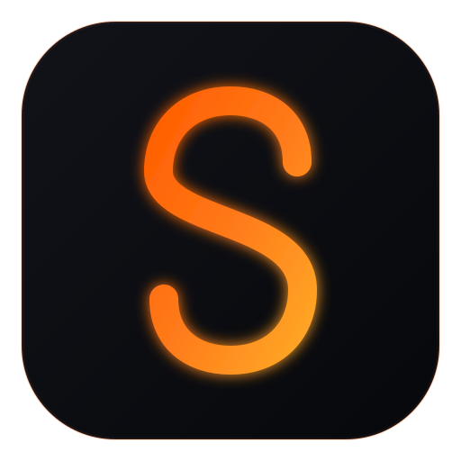
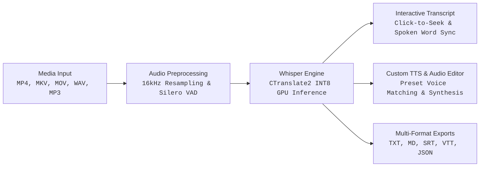

<div align="center">



# Scriber Studio

**High-Performance Speech Recognition, Audio Studio, and Custom TTS for Windows**

[](https://www.python.org/downloads/)
[](https://github.com/SYSTRAN/faster-whisper)
[](https://developer.nvidia.com/cuda-toolkit)
[](https://developer.microsoft.com/en-us/microsoft-edge/webview2/)
[](#overview)
[](LICENSE)

</div>

---

## Overview

**Scriber Studio** is a standalone Windows desktop application for high-throughput speech recognition, audio editing, real-time synchronized playback, and custom text-to-speech synthesis.

Transcription runs entirely on your local workstation with optional NVIDIA CUDA acceleration. The voice synthesis studio features a curated 28-voice suite using Microsoft Edge neural TTS with automatic offline Windows SAPI and formant companion fallbacks. No credit meters, subscriptions, or paid API keys are required.



---

## Core Capabilities

### 1. Ultra-Fast GPU-Accelerated Transcription & Telemetry
- **CTranslate2 & Faster-Whisper Backend**: Leverages INT8 transformer quantization for minimal VRAM footprint and maximum processing speed.
- **NVIDIA CUDA Optimization**: Auto-detects and binds to local NVIDIA RTX GPUs with preloaded cuBLAS runtime libraries.
- **Fast GPU Performance**: Transcribes the tested 15–30s clips in **0.55s – 1.12s** on an RTX 5050 GPU (22× or faster than real-time playback).
- **Precision Telemetry & Dynamic ETA**: Features genuine audio decoding progress ($0-100\%$), real-time countdown ETA, decoding position, and live speed factor monitoring.
- **Multi-Model Support**: Switch seamlessly between Whisper Turbo (`large-v3-turbo`), Distil-Whisper (`distil-large-v3`), and lightweight Base models.

### 2. Synchronized Audio Playback & Word-Level Tracking
- **Universal Media Playback**: Transcodes complex and non-browser containers (such as 4K MKV with EAC3 5.1 Atmos) into clean 16kHz mono speech streams for instant playback in WebView2.
- **HTTP 206 Byte-Range Streaming**: Enables fluid timeline scrubbing and seeking without buffering entire files.
- **Real-Time Word Highlighting**: Interactive `.word-token` spans follow audio playback in real time, with active segment cards autoscrolling into view.
- **Click-to-Seek**: Click any word or transcript segment to seek the playback head directly to that precise timestamp.

### 3. Custom TTS & Precision Audio Editor
- **Preset Voice Matching**: Matches the selected studio voice's pitch, rate, and loudness. The match score is an estimate, not biometric verification.
- **28-Voice Studio Suite**: Curated voices across 9 locales with pitch and rate offset controls.
- **Built-In Audio Editor**: Non-destructive audio editor with semitone pitch tuning, linear volume gain scaling, and waveform trim bounds with direct MP3 export.

### 4. Native Desktop Application
- **Zero Console Flashes**: Standardized Windows Subsystem 2 GUI execution via `Scriber.vbs` or `python run_desktop.py`.
- **Smart App Control (SAC) Compliant**: Desktop shortcuts and the `Scriber.bat` / `Scriber.vbs` launchers prefer the verified signed CPython runtime, preventing Windows 11 Application Control (WDAC) blocks. The packaged `dist\Scriber\Scriber.exe` remains available for machines whose policy trusts the build.
- **Dark Obsidian Aesthetics**: Custom responsive interface with Obsidian (`#08090C`), Tangerine Orange (`#FF5E00`), and Antique Gold (`#E5A93C`) accents.

---

## Performance Benchmarks

Measured on local hardware (NVIDIA GeForce RTX 5050 Laptop GPU, Windows 11; illustrative historical measurements on the listed hardware, not a CI guarantee):

| Media Sample | Duration | Processing Time | Real-Time Factor | Transcription Status |
| :--- | :---: | :---: | :---: | :---: |
| **Standard Monologue (Clean Speech)** | 25.5s | **0.79s** | **32.6× real-time** | Timestamped & Verified |
| **Fast Cadence Male Speech** | 19.1s | **0.68s** | **28.1× real-time** | Timestamped & Verified |
| **Calm Female Speech** | 15.3s | **0.55s** | **27.8× real-time** | Timestamped & Verified |
| **Multi-Turn Conversational Dialogue** | 30.2s | **1.12s** | **27.0× real-time** | Timestamped & Verified |
| **High-Density Fast Exchange** | 18.0s | **0.82s** | **22.0× real-time** | Timestamped & Verified |

---

## Quickstart

### Running the Desktop App

Launch Scriber using the desktop shortcut or native launchers:

```powershell
# 1. Double-click the Desktop shortcut:
Scriber.lnk

# 2. Or run via the silent VBScript launcher (no console window):
.\Scriber.vbs

# 3. Or run the batch launcher:
.\Scriber.bat
```

### Running from Source

```powershell
# 1. Clone repository
git clone https://github.com/LakshyaPrasher/Scriber.git
cd Scriber

# 2. Create and activate a Python 3.12 environment
python -m venv .venv
.venv\Scripts\activate

# 3. Install Scriber and its runtime dependencies
pip install -e .

# 4. Launch the desktop studio
python run_desktop.py
```

> **Requirements:** Windows 10/11 with WebView2, FFmpeg on `PATH` (or set `FFMPEG_PATH`), and a first-run model download for faster-whisper. The Edge neural voice engine needs network access; offline Windows SAPI and formant fallbacks are available.

### Command-Line Interface (CLI)

```powershell
# Transcribe media file with high-accuracy timestamps
python -m scriber.cli process "interview.mp4"

# Transcribe and translate non-English media to English
python -m scriber.cli process "meeting.mp4" --task translate

# Start the local web studio server on port 8080
python -m scriber.cli serve --port 8080

# Install or refresh Windows Desktop and Start Menu shortcuts
python -m scriber.cli shortcut --install
```

---

## Repository Structure

```text
Scriber/
├── scriber/                     # Core application package
│   ├── assets/                  # Application icons, vectors, and avatar
│   ├── services/                # Local companion microservices
│   ├── web/                     # HTTP server, UI renderer, and static assets
│   │   ├── server.py            # Local HTTP server with Range streaming & CORS
│   │   └── static/              # Vanilla JS studio, HTML5 canvas, styles
│   ├── audio_editor.py          # Miniaudio waveform editing & MP3 encoding
│   ├── audio_extractor.py       # FFmpeg audio ingestion & 16kHz conversion
│   ├── cli.py                   # Command-line interface & shortcut installer
│   ├── desktop.py               # pywebview Edge WebView2 desktop harness
│   ├── exceptions.py            # Custom domain exceptions
│   ├── exporters.py             # Export pipelines (TXT, SRT, VTT, MD, JSON)
│   ├── models.py                # Dataclasses & telemetry contracts
│   ├── pipeline.py              # End-to-end orchestration pipeline
│   ├── quality.py               # Transcription quality heuristics
│   ├── transcription_engine.py  # Faster-Whisper CTranslate2 INT8 engine
│   ├── validator.py             # NIST WER/CER cryptographic verification
│   └── voice_clone.py           # Voice profiles & TTS synthesis
├── tests/                       # Comprehensive pytest suite (unit, e2e, stress)
├── docs/                        # Architecture guides & documentation
├── scripts/                     # Tooling & packaging helpers
├── build_desktop.py             # PyInstaller standalone bundling script
├── run_desktop.py               # Main windowed desktop launcher
├── Scriber.bat                  # Windows batch launcher
├── Scriber.vbs                  # Windows silent VBScript launcher
├── scriber.spec                 # PyInstaller packaging specification
├── pyproject.toml               # Package build configuration & entry points
├── requirements.txt             # Primary production dependencies
├── README.md                    # Project documentation
└── LICENSE                      # MIT License
```

---

## Automated Test Battery

The project maintains an automated test battery with **500+ tests**:

```powershell
# Run the complete test suite
.venv\Scripts\python.exe -m pytest tests/ -q

# Run UI contract and challenger regression suites
.venv\Scripts\python.exe -m pytest tests/test_ui_contracts.py tests/test_challenger_m11.py -v

# Run live audio playback & synchronization end-to-end test
.venv\Scripts\python.exe tests/test_live_audio_playback_e2e.py
```

---

## Architecture & Technology Stack

| Component | Technology | Role |
| :--- | :--- | :--- |
| **Speech Recognition** | [faster-whisper](https://github.com/SYSTRAN/faster-whisper) (CTranslate2) | Transformer speech-to-text with INT8 quantization |
| **Voice Activity Detection** | Silero VAD | Speech boundary segmentation & ambient noise rejection |
| **Desktop Shell** | [pywebview](https://pywebview.flowrl.com/) (Edge WebView2) | Native Windows desktop window & OS integration |
| **Audio Transport & Sync** | HTML5 Audio + Range Streaming (206) | Fluid scrub seeking, play/pause, and real-time word tracking |
| **Voice Synthesis** | Edge neural TTS, Windows SAPI, formant vocoder | Pitch/rate-matched synthesis with disclosed heuristic metrics |
| **Packaging** | PyInstaller 6.x | Portable Windows distribution bundle |

---

## License

Distributed under the [MIT License](LICENSE).
