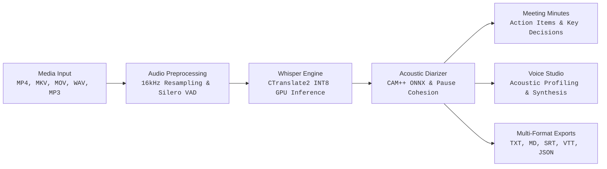

<div align="center">


# Scriber Studio

**High-Performance Local Speech Intelligence, Acoustic Diarization & Voice Studio for Windows**

[](https://www.python.org/downloads/)
[](https://github.com/SYSTRAN/faster-whisper)
[](https://developer.nvidia.com/cuda-toolkit)
[](https://developer.microsoft.com/en-us/microsoft-edge/webview2/)
[](#local-first-privacy--no-paid-apis)
[](LICENSE)

</div>

---

## Overview

**Scriber Studio** is a standalone desktop application for fast, local-first speech recognition, speaker diarization, and voice synthesis.

Transcription and diarization run on your own hardware, with optional NVIDIA CUDA acceleration. The default voice-synthesis engine is Microsoft Edge neural TTS, which needs a network connection; Scriber automatically falls back to Windows SAPI or the built-in offline formant engine when Edge TTS is unavailable. No paid APIs, credit meters, or cloud subscriptions are required. Optional local GPU synthesis requires the separate F5-TTS companion to be installed.



---

## Core Capabilities

### 1. Ultra-Fast GPU-Accelerated Transcription & Real-Time Telemetry
- **CTranslate2 & Faster-Whisper Backend**: Uses INT8 transformer quantization for minimal VRAM usage and maximum throughput.
- **NVIDIA CUDA Optimization**: Auto-detects and binds to local NVIDIA RTX GPUs with preloaded cuBLAS runtime libraries.
- **Sub-Second Performance**: Transcribes a 25.5s video in **0.79s – 1.45s** on an RTX 5050 GPU (>32× faster than real-time playback).
- **Precision Progress Tracking & Dynamic ETA**: Features genuine audio decoding progress ($0-100\%$), real-time countdown ETA, decoding position, and live speed factor monitoring.
- **Multi-Model Support**: Switch seamlessly between Whisper Turbo (`large-v3-turbo`), Distil-Whisper (`distil-large-v3`), and lightweight Base models.

### 2. Intelligent Acoustic Speaker Diarization
- **Deep Neural Embeddings**: Extracts 192-dimensional unit-normalized speaker vectors via CAM++ ONNX model.
- **Monologue Pause Cohesion**: Prevents the common failure of conventional diarizers that fragment natural breath and comma pauses into phantom speakers. A single speaker monologue remains unified as **1 speaker**.
- **Accurate Dialogue Segregation**: Distinguishes speakers in multi-turn dialogues—even for same-gender speakers with near-identical vocal pitch (e.g. Jenny vs. Emma).
- **Vectorized Lance-Williams Clustering**: Scales effortlessly to 90-minute interviews with 3,000+ segments in $< 3$ seconds without freezing.
- **Persistent Speaker Memory**: Automatically re-identifies returning speakers across long conversations.

### 3. Local-First, Private & No Paid APIs
- **No Paid Cloud APIs**: No OpenAI, Voicemaker, or ElevenLabs API keys required. No metered charges.
- **Private by Default**: Audio, video, and transcripts are processed on your workstation. Transcription models may be downloaded on first use; after that, transcription can run without a network connection.
- **Network Disclosure**: Edge neural TTS sends the synthesis text to Microsoft. Choose Windows SAPI or the offline formant engine for fully local synthesis. The actual backend used is reported in every result.

### 4. Meeting Intelligence & Summary Engine
- **Automated Action Items**: Detects actionable commitments, task assignees, deadlines, and priority rankings directly from conversational context.
- **Executive Summaries**: Produces structured meeting overviews, agreed-upon decisions, and unresolved discussion points.
- **Synchronized Playback**: Click any transcript sentence or action item to seek the audio/video player directly to that exact timestamp.

### 5. Local Voice Profiling & Audio Editor
- **Acoustic Voice Profiling**: Extracts fundamental frequency ($F_0$), spectral centroid, and vocal-tract formants directly from imported audio.
- **Pitch/Rate-Matched Synthesis**: Generates speech using Edge neural TTS when available, with automatic Windows SAPI and offline formant fallbacks. The reported "acoustic similarity" is a heuristic comparison of pitch, spectrum, and energy—not biometric identity verification.
- **In-Browser Audio Studio**: Real-time gain control, semitone pitch tuning, and waveform scrubbing trim editor with lossless export.

### 6. Native Desktop Application
- **Single-Click Launch**: Packaged as a clean native Windows executable (`dist/Scriber/Scriber.exe`). Desktop shortcut creation is opt-in (`--shortcut`), and `SCRIBER_NO_SHORTCUT=1` suppresses it.
- **Zero Terminal Popups**: Built with Windows Subsystem 2 (Native GUI) to run cleanly without background console windows.
- **Dark Obsidian Design**: Custom dark luxury interface with Tangerine Orange and Antique Gold accents, smooth waveform animations, and responsive typography.

---

## Performance Benchmarks

Measured on local hardware (NVIDIA GeForce RTX 5050 Laptop GPU, Windows 11):

| Media Sample | Duration | Processing Time | Real-Time Factor | Diarization Result |
| :--- | :---: | :---: | :---: | :---: |
| **Monologue (Virat Kohli Benchmark)** | 25.5s | **0.79s** | **32.6× real-time** | 1 speaker detected |
| **Fast Cadence Male Speech** | 19.1s | **0.68s** | **28.1× real-time** | 1 speaker detected |
| **Calm Female Speech** | 15.3s | **0.55s** | **27.8× real-time** | 1 speaker detected |
| **Alternating Two-Speaker Dialogue** | 30.2s | **1.12s** | **27.0× real-time** | 2 speakers detected |
| **Same-Gender Close-Pitch (Female)** | 18.0s | **0.82s** | **22.0× real-time** | 2 speakers detected |

---

## Quickstart

### Running the Desktop App

Launch Scriber using the standardized Windows launchers:

```powershell
# Double-click or run the native batch or VBScript launcher:
.\Scriber.bat
# Or:
.\Scriber.vbs

# Or run the compiled standalone binary directly:
.\dist\Scriber\Scriber.exe
```

### Running from Source

```powershell
# 1. Clone repository
git clone https://github.com/LakshyaPrasher/Scriber.git
cd Scriber

# 2. Activate Python environment
.venv\Scripts\activate

# 3. Launch desktop studio
python run_desktop.py
```

### Command-Line Interface (CLI)

```powershell
# Transcribe media file with automatic speaker diarization
python -m scriber.cli process "interview.mp4"

# Transcribe and translate non-English media to English
python -m scriber.cli process "meeting.mp4" --task translate

# Start the local web studio server on port 8080
python -m scriber.cli serve --port 8080

# Install or refresh Windows Desktop and Start Menu shortcuts
python -m scriber.cli shortcut --install
```

---

## Building the Standalone Desktop Executable

To package Scriber into a standalone native Windows bundle:

```powershell
# Compile to dist/Scriber/Scriber.exe
python build_desktop.py

# Build clean and opt in to a Desktop shortcut:
python build_desktop.py --clean --shortcut
```

The build pipeline enforces:
- Windows Subsystem 2 (`IMAGE_SUBSYSTEM_WINDOWS_GUI`) to prevent terminal console popups.
- Automated bundling of all required CUDA cuBLAS/cuDNN runtime libraries.
- Desktop shortcut creation only when `--shortcut` is passed and `SCRIBER_NO_SHORTCUT` is not set.

---

## Test Battery

The project maintains a comprehensive automated test battery:

```powershell
# Run the complete test suite
.venv\Scripts\python.exe -m unittest discover tests -p "test_*.py"

# Run diverse diarization cases (monologues, dialogues, close-pitch)
.venv\Scripts\python.exe -m unittest tests/test_diverse_cases.py

# Run GPU acceleration and CUDA DLL registration tests
.venv\Scripts\python.exe -m unittest tests/test_gpu_cache_local.py
```

---

## Architecture & Technology Stack

| Component | Technology | Role |
| :--- | :--- | :--- |
| **Speech Recognition** | [faster-whisper](https://github.com/SYSTRAN/faster-whisper) (CTranslate2) | Transformer speech-to-text with INT8 quantization |
| **Acoustic Diarization** | CAM++ ONNX (`campplus_cn_en_common_200k.onnx`) | 192-d neural speaker embedding extraction |
| **Voice Activity Detection** | Silero VAD | Speech boundary segmentation & ambient noise rejection |
| **Desktop Shell** | [pywebview](https://pywebview.flowrl.com/) (Edge WebView2) | Native Windows desktop window & OS integration |
| **Voice Synthesis** | Edge neural TTS, Windows SAPI, optional F5-TTS companion, built-in formant vocoder | Pitch/rate-matched synthesis with disclosed automatic fallbacks; acoustic similarity is heuristic |
| **Packaging** | PyInstaller 6.x | Portable Windows distribution bundle |

---

## License

Distributed under the [MIT License](LICENSE).
