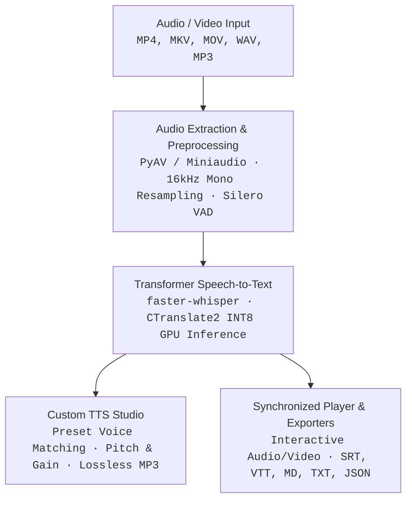

# Scriber Architecture & Design Specifications

Scriber is an offline-first, high-performance desktop studio for speech recognition, audio editing, and preset custom TTS for Windows 11 / 10.

---

## 1. System Architecture Overview

The system runs on local hardware with zero telemetry and no paid API subscriptions. Transcription is fully local. The default voice engine uses Microsoft Edge neural TTS, which makes a network request to Microsoft; when it is unavailable, Scriber falls back to offline Windows SAPI or the built-in formant synthesizer and reports which backend was used.

---

## 2. Core Subsystems

### 2.1 Hardware Detection & Device Routing (`scriber.hardware`)
- **Probing Mechanisms**: Direct Win32 dynamic library bindings to `nvml.dll` (NVIDIA Management Library) and `d3d12.dll` (DirectX 12 Graphics Infrastructure).
- **Dynamic Routing**:
  - NVIDIA RTX / GTX GPU ($\ge 4$ GB VRAM): Dispatches CTranslate2 INT8/FP16 transformer inference to `cuda`.
  - Integrated GPU / CPU: Automatically falls back to multi-threaded CPU inference (`cpu`) with `int8` quantization.
- **REST Telemetry**: Exposes `/api/hardware` with device name, compute capability, VRAM utilization, and recommended compute paths.

### 2.2 Transcription Engine (`scriber.transcription_engine`)
- **Engine**: Faster-Whisper backed by CTranslate2.
- **Model**: Whisper Large-v3-Turbo (`deepdml/faster-whisper-large-v3-turbo-ct2`) with dynamic local cache validation.
- **Progress Tracking**: Real-time progress callback providing fractional decoding progress, decoding speed factor (e.g., $54\times$ real-time), and dynamic ETA remaining.
- **Zero API Ingestion for ASR**: Speech recognition is fully local, with no OpenAI or other transcription cloud endpoint.

### 2.3 Desktop Integration & User Interface (`scriber.desktop`, `scriber.web`)
- **Window Shell**: Native Microsoft Edge WebView2 via `pywebview`.
- **UI Architecture**: Obsidian dark theme (`#08090C`) with Tangerine (`#FF5E00`) and Antique Gold (`#FFA826`) accents. Decoupled static assets (`index.html`, `styles.css`, `app.js`) loaded dynamically from `scriber/web/static`.
- **Subsystem 2 Enforcement**: Built with Windows Subsystem 2 (`IMAGE_SUBSYSTEM_WINDOWS_GUI`) to launch cleanly without a black console terminal window.
- **Live Progress Meter**: Interactive progress card with animated progress track, real-time percentage, dynamic ETA, and decoding speed display.
- **Session-Scoped Playback**: The playable speech track and its waveform envelope are derived from the PCM attached to that specific job's output, never from shared pipeline state. This keeps playback length, scrub position, and waveform aligned with the source even when a voice preview or synthesis runs concurrently.

### 2.4 Standardized Entrypoints & Lifecycle Management (`scriber.cli`, `run_desktop.py`)
- **Consolidated Entrypoints**: `Scriber.bat` and `Scriber.vbs` invoke `run_desktop.py` (or compiled `dist/Scriber/Scriber.exe`) consistently without duplicated environment setup.
- **Unified Shortcut CLI**: Windows `.lnk` shortcut creation and Start Menu binding are consolidated into `python -m scriber shortcut --install` via `scriber/cli.py`.
- **Subprocess & Mutex Safety**: Automatic process lifecycle termination via `atexit` and `SIGINT`/`SIGTERM` handlers ensures single-instance mutex release and companion microservice shutdown without leaving orphaned processes.

---

## 3. Technology Stack

| Layer | Component | Implementation |
| :--- | :--- | :--- |
| **GUI Shell** | Window Manager | `pywebview` (Microsoft Edge WebView2, Per-Monitor High-DPI V2) |
| **Frontend** | Dark Obsidian Studio | Vanilla HTML5 / CSS3 / ES6, Web Audio API waveform visualizers |
| **Server** | Local Loopback REST API | Python standard library `http.server.ThreadingTCPServer` |
| **ASR** | Speech-to-Text | `faster-whisper` (CTranslate2 INT8 Transformer) |
| **Audio Processing** | Demuxing & DSP | `PyAV`, `miniaudio`, `scipy.signal` |
| **Synthesis** | Voice Generation | Edge-TTS, Local Acoustic Inversion, Parametric Rosenberg Vocoder |
| **Packaging** | Windows Distribution | PyInstaller 6.x Standalone Directory Bundle |
