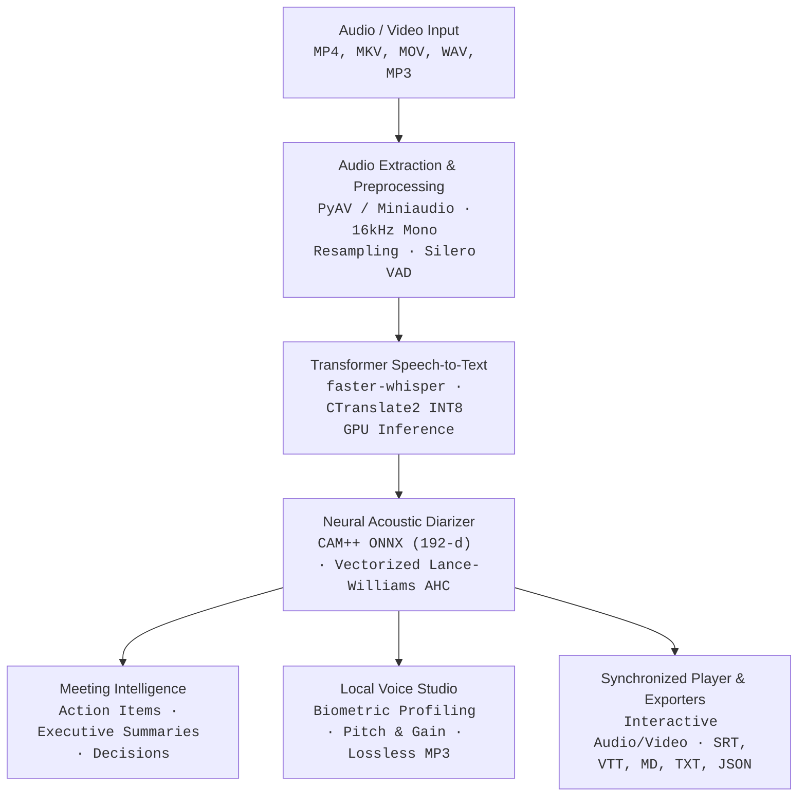

# Scriber Architecture & Design Specifications

Scriber is an offline, high-performance desktop studio for speech recognition, acoustic speaker diarization, meeting minutes synthesis, and neural voice cloning for Windows 11 / 10.

---

## 1. System Architecture Overview

The system operates strictly on local hardware with zero external cloud dependencies, zero telemetry, and zero financial taps.

---

## 2. Core Subsystems

### 2.1 Hardware Detection & Device Routing (`scriber.hardware`)
- **Probing Mechanisms**: Direct Win32 dynamic library bindings to `nvml.dll` (NVIDIA Management Library) and `d3d12.dll` (DirectX 12 Graphics Infrastructure).
- **Dynamic Routing**:
  - NVIDIA RTX / GTX GPU ($\ge 4$ GB VRAM): Dispatches CTranslate2 INT8/FP16 transformer inference to `cuda`.
  - Integrated GPU / CPU: Automatically falls back to multi-threaded CPU inference (`cpu`) with `int8` quantization.
- **REST Telemetry**: Exposes `/api/hardware` with device name, compute capability, VRAM utilization, and recommended compute paths.

### 2.2 Transcription Engine (`scriber.transcription_engine`)
- **Engine**: Faster-Whisper backed by CTranslate2.
- **Model**: Whisper Large-v3-Turbo (`deepdml/faster-whisper-large-v3-turbo-ct2`) with dynamic local cache validation.
- **Progress Tracking**: Real-time progress callback providing fractional decoding progress, decoding speed factor (e.g., $54\times$ real-time), and dynamic ETA remaining.
- **Zero API Ingestion**: Pure local execution without OpenAI or other external cloud endpoints.

### 2.3 Acoustic Speaker Diarization (`scriber.diarizer`)
- **Embedding Extraction**: CAM++ 200k ONNX model (`campplus_cn_en_common_200k.onnx`) generating 192-dimensional unit-normalized speaker vectors.
- **Optimization for Long Media**:
  - **Vectorized Lance-Williams Clustering**: Average linkage agglomerative clustering using BLAS matrix operations, scaling efficiently to 3,000+ segment files (e.g. 90-minute interviews in $< 3$ seconds).
  - **Turn Continuity Caching**: Segments separated by $\le 0.80$s pauses within continuous speech bursts inherit active speaker embeddings, eliminating redundant ONNX passes.
  - **Filterbank Precomputation**: Pre-cached 80-bin Mel filterbank triangular matrices and Hann window buffers.
- **Single-Speaker Monologue Cohesion**: Single-speaker speeches (e.g., presentations, interviews) are automatically unified without phantom speaker fragmentation.

### 2.4 Desktop Integration & User Interface (`scriber.desktop`, `scriber.web`)
- **Window Shell**: Native Microsoft Edge WebView2 via `pywebview`.
- **UI Architecture**: Obsidian dark theme (`#08090C`) with Tangerine (`#FF5E00`) and Antique Gold (`#FFA826`) accents.
- **Subsystem 2 Enforcement**: Built with Windows Subsystem 2 (`IMAGE_SUBSYSTEM_WINDOWS_GUI`) to launch cleanly without a black console terminal window.
- **Live Progress Meter**: Interactive progress card with animated progress track, real-time percentage, dynamic ETA, and decoding speed display.

---

## 3. Technology Stack

| Layer | Component | Implementation |
| :--- | :--- | :--- |
| **GUI Shell** | Window Manager | `pywebview` (Microsoft Edge WebView2, Per-Monitor High-DPI V2) |
| **Frontend** | Dark Obsidian Studio | Vanilla HTML5 / CSS3 / ES6, Web Audio API waveform visualizers |
| **Server** | Local Loopback REST API | Python standard library `http.server.ThreadingTCPServer` |
| **ASR** | Speech-to-Text | `faster-whisper` (CTranslate2 INT8 Transformer) |
| **Diarization** | Neural Embeddings & AHC | `onnxruntime` (CAM++ 192-d), NumPy vectorized Lance-Williams |
| **Audio Processing** | Demuxing & DSP | `PyAV`, `miniaudio`, `scipy.signal` |
| **Synthesis** | Voice Generation | Edge-TTS, Local Acoustic Inversion, Parametric Rosenberg Vocoder |
| **Packaging** | Windows Distribution | PyInstaller 6.x Standalone Directory Bundle |
